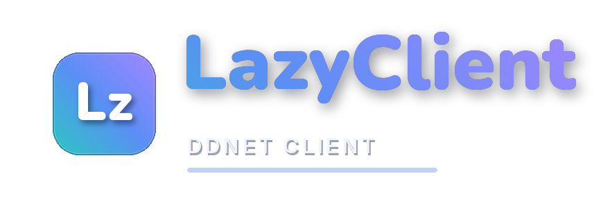

# LazyClient

LazyClient is a local-first fork of [TClient](https://github.com/TaterClient/TClient)
and [DDNet](https://ddnet.org/) with a focused gores settings layer. It keeps
the upstream client, protocol, and configuration compatibility while adding a
small set of client-side tools for hook-heavy maps.

LazyClient is built on TClient 10.9.x / DDNet 20.x. The current release is
**0.1.0** and targets **Linux** first.

## Fair play and privacy

LazyClient is fair-play only. It does not include aim assistance, hidden
information, or server-side gameplay changes, and it does not use accounts,
telemetry, a KoG API, or a general presence service. Optional input helpers are
off by default. The optional BestClient client-icon lookup only downloads
BestClient's public player list to match names on the current server; it can be
disabled in **Settings → LazyClient → Visuals**. Server and community rules may
be stricter than the client, so use those features only where they are allowed.

## Build from source

### Debian / Ubuntu

```sh
sudo apt install build-essential cmake git ninja-build \
  libcurl4-openssl-dev libfreetype-dev libharfbuzz-dev \
  libogg-dev libopus-dev libopusfile-dev libpng-dev \
  libsdl2-dev libssl-dev
```

Optional dependencies:

```sh
# Video recording
sudo apt install libavcodec-dev libavformat-dev libavutil-dev libswresample-dev libswscale-dev

# Vulkan backend
sudo apt install libvulkan-dev

# WebSocket support
sudo apt install libwebsockets-dev
```

### Arch Linux

```sh
sudo pacman -S --needed base-devel cmake git ninja curl freetype2 harfbuzz \
  libogg opus opusfile libpng sdl2 openssl
```

### Compile

```sh
git clone --recursive https://github.com/DASIEU/LazyClient.git
cd LazyClient
git submodule update --init --recursive

cmake -S . -B build -G Ninja \
  -DCMAKE_BUILD_TYPE=Release \
  -DPREFER_BUNDLED_LIBS=ON
cmake --build build -j"$(nproc)"
```

Run the client:

```sh
./build/LazyClient
```

The server target remains `DDNet-Server` for compatibility with existing server
tooling. More build options are documented in [`docs/BUILDING.md`](docs/BUILDING.md).

## Configuration

LazyClient deliberately keeps DDNet's save directory (`DDNet`) so it can share
data with an existing DDNet/TClient installation:

| File | Purpose |
| --- | --- |
| `settings_ddnet.cfg` | Existing DDNet settings |
| `settings_tclient.cfg` | Existing TClient settings |
| `settings_lazy.cfg` | LazyClient settings (`lc_*`) |

Existing `tc_*` variables are not renamed or removed. LazyClient settings use
the `lc_` prefix and the `LAZY` config domain, and can be opened from
**Settings → LazyClient → Miscellaneous**.

The LazyClient settings page has five tabs: **Game**, **Visuals**, **Chat
triggers**, **Miscellaneous**, and **Info**. Only implemented controls are
shown.

## Updates

LazyClient checks the latest GitHub Release and links to it. Update checks are
informational; release artifacts are installed manually. The long-term plan is
a signed release/update pipeline, but 0.1.0 does not include an installer or
automatic updater.

## Upstream and branches

LazyClient is a fork, not a replacement for TClient or DDNet:

- `master` tracks upstream TClient.
- `lazy` is the LazyClient development branch.
- Feature work happens on short-lived branches based on `lazy`.

Upstream changes are merged so LazyClient stays current with protocol, security,
and platform fixes.

## Credits

LazyClient would not exist without **DDNet** (Dennis Felsing and contributors),
**TClient** (Tater and contributors), **DDRace**, **Teeworlds** (Magnus Auvinen
and contributors), and the gores servers and players that shaped the feature
set.

LazyClient code and design by **DASI**. Client indicator research and assets
from RushieClient and BestClient are attributed in [`NOTICE.md`](NOTICE.md) and
the relevant asset directories.

## License

LazyClient is an altered source version of TClient, which is a fork of DDNet.
The original zlib license and third-party notices are preserved in
[`license.txt`](license.txt). Additional attribution is in [`NOTICE.md`](NOTICE.md).

LazyClient is not affiliated with or endorsed by DDNet, TClient, King of Gores,
FoxNet, RushieClient, or BestClient.

## Disclaimer

This software is provided **as-is**, without warranty of any kind. Use it at
your own risk. Server owners may have rules that differ from LazyClient's
feature set; follow those rules.
